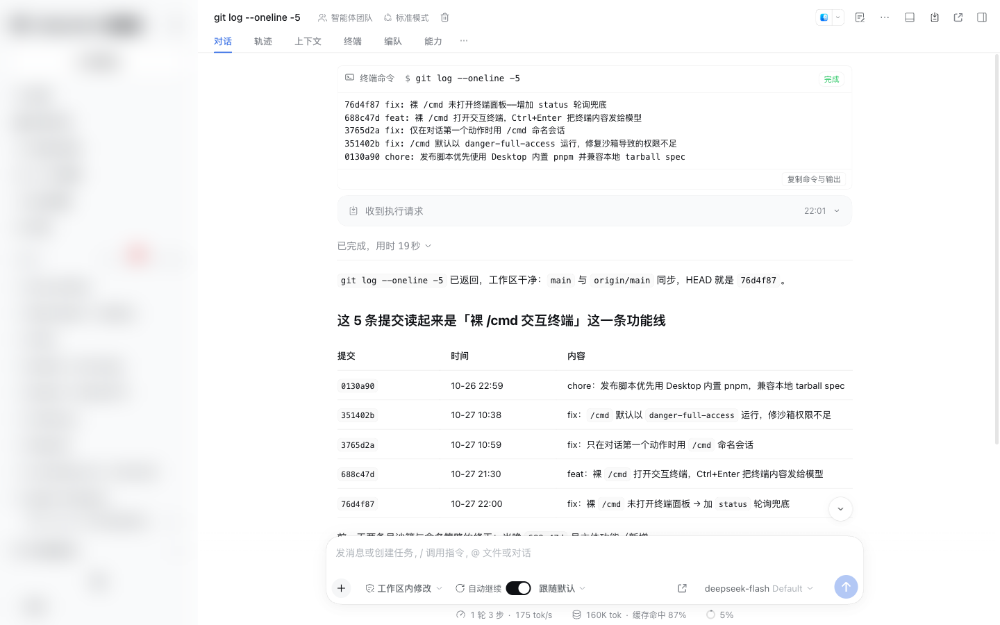
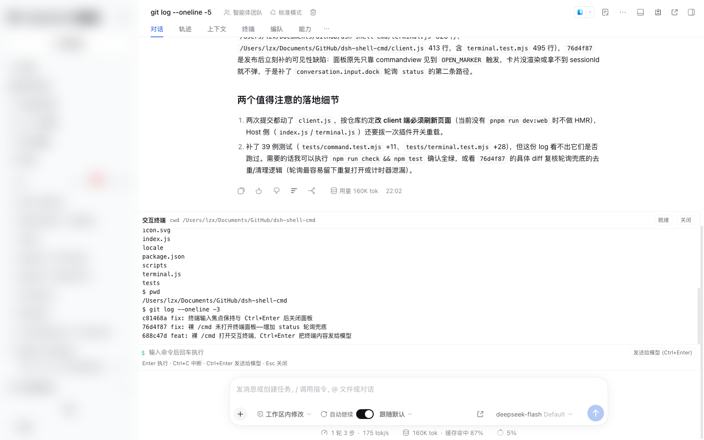
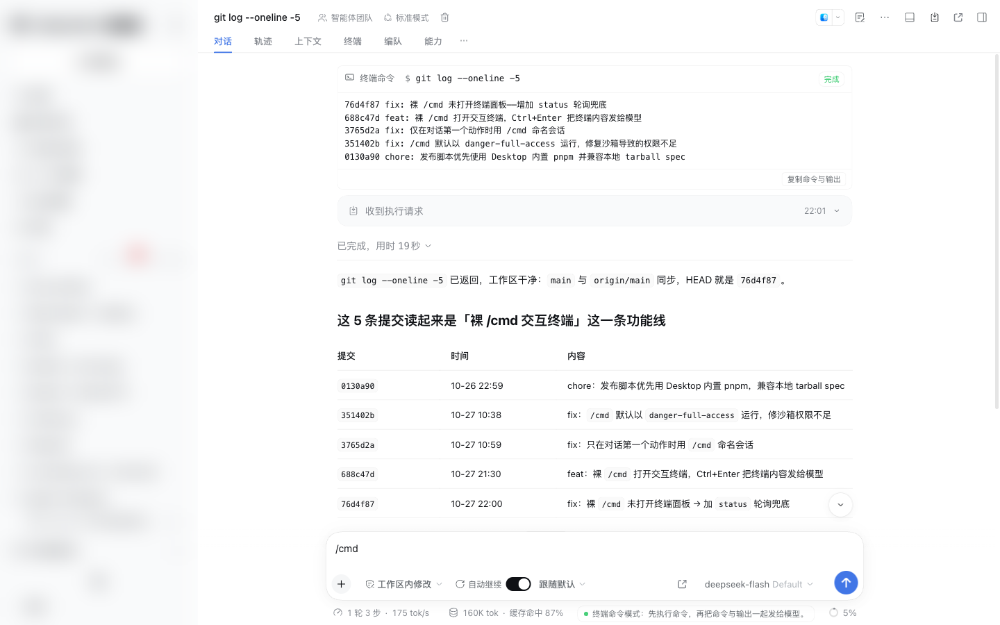

# dsh-shell-cmd

DeepSeek Harness（dsh）插件，提供两种终端输入方式：

- `/cmd <终端命令>`：**先执行命令**，再把「命令 + 输出」一起发给模型，并在对话里以**终端卡片**渲染；
- 裸 `/cmd`：直接打开**交互终端模态**（背景模糊、居中卡片），逐条执行命令，按 **Ctrl+Enter** 把整段终端内容发给模型，并在对话里保留一条**终端卡片**。

对标 Claude Code 的 `!<command>` 能力，区别是这里会把命令与输出明确交给模型，并要求模型据此回复。

## 效果

```
你： /cmd git status --short

  ⬢ 终端命令  $ git status --short              [完成]
  ┌────────────────────────────────────────────────────┐
  │ M src/App.tsx                                      │
  │ ?? tests/new.test.ts                               │
  └────────────────────────────────────────────────────┘
  M src/App.tsx · ?? tests/new.test.ts        [展开全部 2 行] [复制命令与输出]

模型：当前工作区有 1 个已修改文件和 1 个未跟踪文件……
```

- 命令卡片：等宽字体、`$` 提示符、状态胶囊（执行中 / 退出码 / 超时 / 取消）、可展开的长输出、复制按钮。
- 交互终端：裸 `/cmd` + Enter 直接打开模态（token 被消费、草稿自动清空，体验与 `/context` 一致），Enter 逐条执行、Ctrl+Enter 发送给模型（对话里保留一条终端卡片）、Esc / 点遮罩关闭（详见下文）。
- 输入提示：输入框草稿进入 `/cmd` 模式时，下方出现「终端命令模式」提示条。
- 模型输入：一条 user 消息，正文包含「用户手动执行了此命令」、命令原文、cwd、退出状态与 stdout/stderr。
- 会话标题：**仅当 `/cmd` 是对话第一个动作时**，用命令本身命名会话（见「会话标题规则」）。
- 历史回放：卡片从 `command/run` + `command/done` 折叠出的 `CommandNode` 重建，重开会话/刷新后仍在。

## 截图

真实运行截图（`docs/screenshots/`，左侧会话栏已模糊处理）：

| 终端卡片 | 交互终端（裸 `/cmd`） |
| --- | --- |
|  |  |

输入框进入 `/cmd` 模式时，状态栏会提示「终端命令模式：先执行命令，再把命令与输出一起发给模型。」：



## 使用

1. 在输入框键入 `/`，从命令菜单选择 **cmd**（或直接输入 `/cmd `），菜单会显示命令说明与输入提示。
2. 在 `/cmd ` 之后写终端命令，回车提交。命令在**当前会话工作目录**执行。
3. 命令结束后，模型会自动收到命令与输出并给出回复。
4. 只输入 `/cmd` 并回车（不带命令）：立即打开交互终端模态，草稿自动清空（见「交互终端模式」）。

示例：

```
/cmd ls -la
/cmd git log --oneline -5
/cmd cat package.json
/cmd npm test
```

### 行为细节

| 情况 | 表现 |
| --- | --- |
| 命令退出码非 0 | 卡片显示红色 `退出 N` 胶囊；输出照常发给模型（非零退出是结果，不是插件错误） |
| 命令超时 | 默认 120s 后杀掉进程，卡片显示 `已超时`，输出与超时标记发给模型 |
| 执行器报错（如无法启动） | 卡片显示错误文本，**不会**触发模型轮次 |
| 输出过长 | 单流最多读取 256 KiB；卡片与模型文本各自截断到 24k 字符并标注省略量 |
| 会话正在运行 | 命令照常执行；命令消息经 `agent.followup()` 排队，等当前轮次结束再送达 |
| 取消 | 命令执行绑定 UI 请求的取消信号；被取消时不向模型发送任何内容 |
| 会话标题 | 执行前用命令命名当前会话（见下节） |
| 权限 / 沙箱 | 默认以 `danger-full-access` 运行（等价终端，见「权限与运行环境」） |

### 交互终端模式（裸 `/cmd`）

只输入 `/cmd` 并回车（**不带命令**），会像 `/context` 一样立即打开一个**居中模态**（不再是输入框下方的 dock）：

```
┌ 交互终端   cwd /Users/me/project                      [就绪] [关闭] ┐
│ $ git status --short                                                 │
│  M src/App.tsx                                                       │
│ $ ls                                                                 │
│ src  package.json                                                    │
└──────────────────────────────────────────────────────────────────────┘
  $ [输入命令…]                                   [发送给模型 (Ctrl+Enter)]
  Enter 执行 · Ctrl+C 中断 · Ctrl+Enter 发送给模型 · Esc 关闭
```

**打开方式**

- 插件通过 `ctx.commandUi.decorate` 给 Host 的 `cmd` 命令挂一个 **bare 调用 action**；
  裸 `/cmd` + Enter 时，commands 客户端先**消费掉 `/cmd` token**（草稿自动清空、不提交任何消息），
  再执行 action 打开模态——与 `/context` 的体验一致。
- 因此不会再出现旧版本的两个问题：「面板提前打开」（claim 阶段就打开）和
  「Esc 关闭后草稿仍是 `/cmd`、又被 claim 副作用重开」。`/cmd <命令>` 仍走 Host 正常执行，装饰只作用于 bare 调用。
- 兜底路径（旧 Host 或装饰未生效时）：commandview 看到裸 `/cmd` 的 `[[dsh-shell-cmd:terminal]]` 标记后打开
  （按 `commandId`/`seq` 去重，回放历史不会重复弹出），以及面板关闭时低频轮询 Host `status` 的 `pendingOpen`。

**外观**

- 注册在 `conversation.input.overlay` 槽位（session 作用域，`id='shell-cmd-terminal'`，`order:20`）。
- 打开时渲染全屏遮罩：`position:fixed; inset:0; z-index:200`，背景 `var(--dsw-alias-bg-mask-1)`，
  `backdrop-filter: blur(3px)`（含 `-webkit-` 前缀）；卡片居中，`width:min(860px,100%)`、
  `max-height:min(82vh,720px)`，圆角 12px、`--dsw-shadow-lv3` 阴影。
- 样式只用 `--dsw-alias-*` 主题令牌，明暗主题自动跟随。

**关闭方式**

- `Esc`：面板打开期间在 `document` 上注册**捕获阶段** `keydown` 监听（输入法 composing 时忽略），
  preventDefault + stopPropagation 后关闭；终端输入框内的 `Esc` 也走同一关闭逻辑（关闭动作有 80ms 幂等去重，不会重复发 RPC）。
- 点击卡片外的遮罩关闭；卡片内的点击不会误关。
- 点击右上角「关闭」按钮。
- 关闭动作：best-effort 调用 RPC `close`（失败忽略）→ 收起模态 → **若输入框草稿 trim 后仍是 `/cmd` 就清空**
  （正常 action 路径草稿已被消费，这里只是防御旧路径残留）。

| 快捷键 | 行为 |
| --- | --- |
| `Enter` | 执行当前输入行，输出追加到终端滚动区；执行结束后焦点仍在输入行 |
| `Ctrl+C` | 命令执行中 → 中断（abort）；空闲时清空输入行 |
| `Ctrl+Enter` | 把整段终端内容作为对话输入发给模型，并在对话里保留一条终端卡片；发送成功后终端模态自动消失 |
| `Esc` | 关闭模态（未发送的内容丢弃） |

终端内行为：

- 每条命令通过 `ctx.shell` 执行，与 `/cmd <命令>` 一样是 `danger-full-access`（等价终端），受 120s 超时与 256 KiB 单流上限保护；
- `cd` 单独处理并跨命令保留当前目录；`export NAME=VALUE` / `unset NAME` 会影响后续命令；
- 输出按行保存在有界滚动区（最多 1200 行 / 96 KiB），只适合**按行执行**的命令；
  全屏交互程序（vim、top、需要 TTY 的程序）不支持；长命令执行期间显示「执行中…」；
- 命令执行期间输入行保持可聚焦（readOnly，不用 disabled），结束后焦点自动回到输入行；输出区自动滚到底部；
- 传输失败（Host 未连接、会话未就绪、超时等）会在模态内按**错误码本地化**展示，并提供**重试**按钮，
  不会再只丢一个 `Failed to fetch`；
- **只有 Ctrl+Enter 才是「发送」**：transcript 经 `agent.followup()` 作为一条 `source.kind='shell-command'` 的消息交给模型；Chat 会给这类消息建 `context` 节点（默认不渲染成普通用户气泡，所以对话里不会重复出现大段 transcript）；
  同时插件在会话日志里 best-effort 追加一对 log-only 的 `command/run` → `command/done`（形状与 `/cmd <命令>` 的命令生命周期一致），
  对话里因此保留一条**终端卡片**：命令行 + 完整 transcript，刷新/重开会话后仍在，可展开、可复制；
- 卡片只是 UI/log 记录，**不进模型上下文**；`Esc`/关闭只删除 Host 侧终端状态，不产生任何模型消息，也不产生卡片；
- `Ctrl+Enter` 后模型收到「用户在一个交互终端里执行了这些命令」的说明 + cwd + 完整 transcript；发送成功后终端模态立即关闭；
  这次发送如果发生在对话开头，同样会用第一条命令命名会话；
- 面板按会话隔离；切换会话不会把当前面板带到别的会话（未发送的终端状态随会话保留，直到关闭/发送）。

**传输**

- Host 侧只保留 `ctx.connection.fetch.register` 的精确路由 `POST /api/cmd-terminal/rpc`（`terminal.js`）；
  `webServer.register` 的根路径 `/cmd-terminal/rpc` 已删除（实测不可达：GET 404 / POST 405）。
- 浏览器半端用**页面相对地址**调用：

  ```js
  fetch('api/cmd-terminal/rpc', {
    method: 'POST',
    credentials: 'same-origin',
    cache: 'no-store',
    headers: { 'content-type': 'application/json' },
    body: JSON.stringify({ method, params: { sessionId, ... } }),
    signal: AbortSignal.timeout(15000),   // send 覆盖执行时长，单独放宽
  })
  ```

- 关键点：**禁止**用 `__DSH_TRANSPORT__.streamBaseUrl` 或 `document.baseURI` 拼绝对地址。桌面端页面 origin 是
  `dsh-app://app`，而 `streamBaseUrl` 是 `http://127.0.0.1:<port>`，拼出来就是跨源请求 → 浏览器直接
  `TypeError: Failed to fetch`。Web/Desktop 壳会把非静态路径 forward 给 Host 并注入认证 cookie（与 dsh-context 的
  `api/dsh-context/…` 同款），认证由桥本身完成。
- 响应不是 JSON / 非 `ok` / 超时 / 网络错误时，统一抛出带 `code` 的错误；模态内按 code 显示本地化文案
  （如 `session-not-found` → 「会话尚未就绪」），并可重试。

### 会话标题规则

**只有当 `/cmd` 是对话的第一个动作时**，才用命令命名会话；对话中途执行的 `/cmd` 不改标题。

判定条件（`isConversationStart()`，两者同时满足才算开始）：

1. 会话还没有任何标题（人工命名、自动生成都算已有）；
2. 会话日志里没有 `user/message` / `turn/start` 活动，且 Agent inbox 里没有待处理输入。

| 场景 | `/cmd` 的行为 |
| --- | --- |
| 新会话（侧边栏「未命名」），第一条输入就是 `/cmd` | 写入命令本身 |
| 对话已经开始（有过普通提示词 / 已有标题）后再 `/cmd` | **不改标题**，命令照常执行并回复 |
| 同一会话里第二次 `/cmd` | 不改标题（第一次已命名） |
| fork / 续接的会话（继承历史消息） | 视为非开始，不改标题 |

命名通过 `ctx.sessionTitle.rename(session, 命令)` 完成（`source: 'user'`，会固定标题，之后自动标题不再覆盖）。命令会先做一行化处理（换行/连续空白折叠为单个空格），最终长度由标题服务的 `maxTitleBytes` 截断。标题失败（例如被服务拒绝）不影响命令执行。若不需要这个行为，在行配置里加 `nameSession: false`。

### 权限与运行环境

**权限（文件/网络）**：`/cmd` 是**人类显式输入**的命令，语义上等价于用户自己开终端执行，默认以
`danger-full-access` 策略交给 `ctx.shell` 执行——即不套 macOS seatbelt 沙箱，可写工作区之外、可联网。

> 注意：不能靠“不传 `sandboxPolicy`”来达到不沙箱。`@deepseek-ai/dsh-bash-sandbox` 的
> `resolve()` 会把缺省值补成**部署默认策略**（`ctx.sandboxPolicy.resolve()`，不带 session），
> 于是命令会跑在部署默认的 workspace root / 模式下。典型症状：在仓库里 `/cmd git pull`
> 报 `error: cannot open .git/FETCH_HEAD: Operation not permitted`，而终端里正常。
> 本插件显式传 `danger-full-access`，所以不会再出现这种“权限和终端不一致”。

需要让 `/cmd` 与**模型 bash 工具**保持同一边界（例如会话策略是 `workspace-write` / `read-only`）时，
在行配置里加 `useSessionPolicy: true`，此时改用该会话的 `ctx.sandboxPolicy.resolve({ session })`。

**环境变量**：命令由 dsh 的本地 bash executor 以 `bash -c` 执行，环境是 **DSH 桌面进程的环境**：

- 不加载你的交互式 shell rc（`~/.zshrc` / `~/.zprofile` / `~/.bash_profile`），因此 `PATH`、函数、别名、
  部分工具链变量可能与终端不同；
- 固定覆盖 `NO_COLOR=1`、`TERM=dumb`、`PAGER=cat`、`GIT_PAGER=cat`（保证输出适合卡片/模型）；
- 不注入 `DSH_*`（除非显式传 `dshEnv`）。

需要登录 shell 环境时，在命令里显式 `source`，或写成 `zsh -lc '…'` / `bash -lc '…'`。

**不是模型工具**：`/cmd` 只由人触发，模型不能调用它；模型只能看到执行结果，不能借此执行命令。

## 安装

本地目录安装（开发中）：

```
plugin_manager action=install_bundle target=/Users/lzx/Documents/GitHub/dsh-shell-cmd
```

安装后 bundle 会写入当前 profile 的 `package.json`（`dsh.profile.bundles`）并插入一行 Host 插件：

```yaml
- insert:
    - id: shell-cmd
      name: dsh-shell-cmd
```

Host 行 / Client 半端分别是 `index.js` 与 `client.js`，由 `package.json` 的 `dsh.bundle.patch` 与 `dsh.client` 声明。

### 从 Git 仓库安装 / 发布（可复用）

开发时用上面的本地链接安装；需要“推送仓库、并从 GitHub 仓库重装到当前 profile”时用脚本：

```bash
scripts/publish-install.sh              # 提交 + push + 用当前 commit 的 GitHub 归档安装 + 校验
scripts/publish-install.sh --dry-run    # 只打印计划
scripts/publish-install.sh --no-push    # 不推送（该 commit 必须已在远端）
scripts/publish-install.sh --profile web --mode git
```

| 选项 | 说明 |
| --- | --- |
| `--profile <name>` | 目标 profile，默认 `$DSH_PROFILE`，否则 `desktop` |
| `--message <msg>` | 自动提交的提交信息 |
| `--mode tarball\|git` | 安装源形式：GitHub 归档 URL（默认）或 `github:owner/repo#sha` |
| `--spec <spec>` | 直接指定交给 `dsh plugin add` 的 spec（私有仓库/自定义源） |
| `--no-push` / `--no-commit` / `--dry-run` | 跳过推送 / 跳过自动提交 / 只打印 |

脚本通过官方 CLI 安装，CLI 会把声明了 `dsh.bundle` 的包自动写入 `dsh.profile.bundles`：

```bash
dsh plugin --profile "$DSH_PROFILE" add --prefer-offline "https://codeload.github.com/<owner>/<repo>/tar.gz/<sha>"
```

macOS Desktop 下脚本会自动使用 App 内置的 runtime pnpm（与插件管理器同版本，避免重解析整个 lockfile）；可用 `DSH_PNPM` 覆盖。前置条件：仓库已配置 `origin`；默认源要求仓库**公开**（匿名 tarball），私有仓库用 `--spec` 传带凭据的 git spec；`dsh` CLI 在 `PATH` 上。安装后 Host 模块需在插件页拨动开关或重启 DSH 才生效；只改 `client.js` 时刷新页面即可。

## 架构

```
方式 A：/cmd <cmd>（一次性）
用户输入 /cmd <cmd>
        │
        ▼
[Host] commands 服务解析并调用 handler
        │  0. （对话开头才）ctx.sessionTitle.rename(session, 命令)
        │  1. ctx.shell.resolve / execute（cwd=会话工作目录，前台等待，带超时与取消）
        │  2. 组装正文：stdout + [stderr] + 状态标记
        │  3. agent.followup(user 消息：命令 + cwd + exit + 输出) ← 模型据此回复
        ▼
[会话日志] session/title + command/run + command/done（均 log-only，不进模型历史）
        │
        ▼
[Client] conversation.chat.commandview，key = "cmd"  →  终端卡片

方式 B：裸 /cmd（交互终端）
裸 /cmd + Enter
        │  [Client] ctx.commandUi.decorate 的 bare action：消费 token（草稿清空、不提交消息）
        ▼
[Client] conversation.input.overlay 居中模态（Esc / 点遮罩 / 关闭按钮）
        │  Enter → POST api/cmd-terminal/rpc { method:"send", text } → ctx.shell 执行
        │  Ctrl+C → { method:"cancel" }；Esc/关闭 → { method:"close" }
        │  Ctrl+Enter → { method:"finish" }
        ▼
[Host terminal.js] 读滚动区 → agent.followup(transcript) → 终端状态删除

兜底触发：旧 Host 的 OPEN_MARKER（commandview 按 commandId/seq 去重）/ status 轮询 pendingOpen
```

关键契约：

- Host 半端导出 `{ name, inject, apply }`，`inject = ['commands', 'shell', 'workingDirectory']`；缺失任一服务时插件保持 inactive 而不是抛错。`sessionTitle` / `webServer` / `connection` / `agents` 均为可选服务（`ctx.get`），缺失时只降级对应能力。
- **不静态 import 任何 `@deepseek-ai/*` 核心包**：本地链接安装的插件在工作区内无法解析 dsh 安装内的包。UserMessage 按 `createUserMessage()` 的等价结构就地构造（`id` / `role` / `content` / `source`）。
- Client 半端是 `window.__ModuleLoader__` 的懒工厂 classic script，只能 `require('react')`，无 JSX；样式经 `<style data-plugin-css>` 注入并在 `ctx.effect` 中清理。
- 卡片注册在 `conversation.chat.commandview`（按命令名键控、`replaceRisk: none` 的公开扩展点），不替换任何内置渲染器；交互终端模态注册在 `conversation.input.overlay`（`id='shell-cmd-terminal'`，session 作用域），提示条仍在 `conversation.composer.dock`。
- 裸 `/cmd` 的打开走 `ctx.commandUi.decorate({ name:'cmd', ui:{ kind:'action', run } })`：`/context` 同款路径，token 被消费后才执行 action；装饰只对 bare 调用生效，`/cmd <args>` 仍由 Host 命令执行。
- 终端 RPC 由 Host 通过 `ctx.connection.fetch.register({ path:'/api/cmd-terminal/rpc', methods:['POST'], requestBody:'buffered' })` 暴露；浏览器半端用**页面相对地址** `fetch('api/cmd-terminal/rpc', { credentials:'same-origin', cache:'no-store' })` 调用，绝不拼 `__DSH_TRANSPORT__.streamBaseUrl` / `document.baseURI` 绝对地址（那会跨源 → `Failed to fetch`）。
- 所有颜色走 `--dsw-alias-*` 主题令牌，明暗主题与主题切换自动跟随。

### 模型看到的输入（示意）

```
The user ran the following shell command from the DSH composer (/cmd). Respond to the user
based on the command and its output; the command was not run by you.

$ git status --short
cwd: /Users/me/project
exit: 0

 M src/App.tsx
?? tests/new.test.ts
```

消息 `source.kind = "shell-command"`。UI 上它表现为一条**默认折叠**的“Execution requested”turn-trigger 通知，正文只在用户主动展开时显示——可见的输入表达始终是上方的终端卡片。

## 可调常量与行配置

`index.js` 顶部导出：

| 常量 | 默认值 | 含义 |
| --- | --- | --- |
| `DEFAULT_TIMEOUT_MS` | `120000` | 单条命令超时（毫秒） |
| `DEFAULT_MAX_OUTPUT_CHARS` | `24000` | 卡片与模型文本各自保留的最大字符数 |
| `STDOUT_MAX_BYTES` | `262144` | 执行器侧单流读取上限 |

当前版本未导出 `Config`（避免依赖 schemastery）；`apply(ctx, config)` 仍会读取行配置中的 `timeoutMs` / `maxOutputChars` / `nameSession` / `useSessionPolicy`（若 Loader 透传）。

## 开发与验证

```bash
npm run check   # node --check index.js && node --check client.js && node --check terminal.js
npm test        # node --test "tests/**/*.test.mjs"  （Host 半端纯函数、执行路径与会话标题单测）
npm run verify  # check + test
```

## 排错

| 现象 | 原因 / 处理 |
| --- | --- |
| 交互终端里报 `Failed to fetch` | 旧版把 RPC 拼成 `http://127.0.0.1:<port>/…` 绝对地址，桌面端 `dsh-app://app` 页面发起就是跨源。0.3.12 起改为页面相对 `api/cmd-terminal/rpc`；确认已刷新页面（client.js 变更需刷新，无 HMR） |
| 裸 `/cmd` 按回车面板不打开 | 先确认 `/cmd` 在命令菜单里且插件行 active；打开由 `ctx.commandUi.decorate` 的 bare action 触发，`dsh.client.inject` 需含 `@deepseek-ai/dsh-client-ui-commands`，改后刷新页面。装饰不可用时仍有兜底：commandview 的 OPEN_MARKER（15s 内、按 commandId/seq 去重）与关闭状态下的 `status` 轮询 |
| 面板关不掉 / Esc 无反应 | Esc 由 document 捕获阶段监听处理（输入法 composing 时忽略），点遮罩或「关闭」按钮也可；若 RPC 失败仍会本地收起模态（close 为 best-effort） |
| 打开后立即报「会话尚未就绪」 | Host 侧 `session-not-found`：会话还没就绪或已被关闭，稍后点「重试」；Host 侧 `/api/cmd-terminal/rpc` 路由需由 `connection.fetch` 注册成功（404 时检查插件是否 active / 是否需重载 Host） |
| 终端里命令跑但看不到输出 | 看模态内错误行是否显示 `busy` / `session-not-found`；确认命令是**按行执行**的（全屏 TUI 不支持），长命令执行期间状态为「执行中…」 |
| 发送给模型后卡片/面板重复出现 | 只有 Ctrl+Enter 会 `finish`；Esc/关闭只清 Host 终端状态，不产生模型消息。若旧版本残留卡片，刷新页面即可 |

## 已知边界

- 卡片渲染只在 **Web / Desktop 的 Chat 视图**生效；纯文本入口（CLI、ACP、JSON-RPC）没有 slash 命令表面，也就没有 `/cmd`。
- 会话全空的“新会话”在第一条命令时可能先记录 `command/run` 再激活会话；卡片随会话激活出现（与内置命令行一致）。
- 会话标题一旦由 `/cmd` 写入即为显式标题（user pin），之后不会再被自动标题改写；不想要这个行为时用 `nameSession: false`。
- 输出上限是为了保护会话日志与模型上下文；需要完整输出时请改用重定向到文件再 `/cmd cat <file>`。
- 一次性 `/cmd <命令>` 是独立的 `bash -c`，`cd` 不跨调用保留；交互终端模式会保留 cwd 与 `export` 的变量，但不保留 shell 函数/别名/后台进程。
- 交互终端是**按行执行**的 REPL：全屏 TUI（vim/top/需要真 TTY 的程序）不支持；长命令执行期间面板显示「执行中…」，完成后一次性显示输出；`Ctrl+C` 只能中断由插件发起的那次命令。
- 交互终端发送后模型收到的是滚动区快照（最多 1200 行 / 96 KiB，模型侧再截断到 24k 字符）；发送完成即结束该终端会话。
- 不加载交互式 shell rc，环境变量来自 DSH 进程而非你的终端；`TERM=dumb` 等覆盖也不适合全屏交互程序。
- 默认 `danger-full-access` 意味着 `/cmd`（含交互终端）与终端一样能写任意路径、访问网络；介意这一点时用 `useSessionPolicy: true` 退回会话沙箱。

## License

MIT
